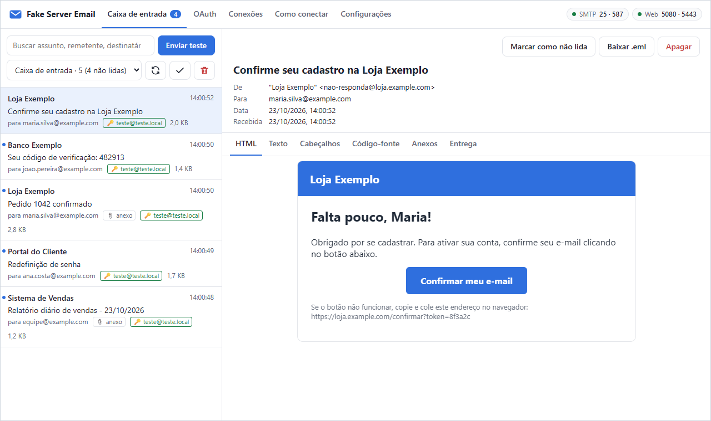
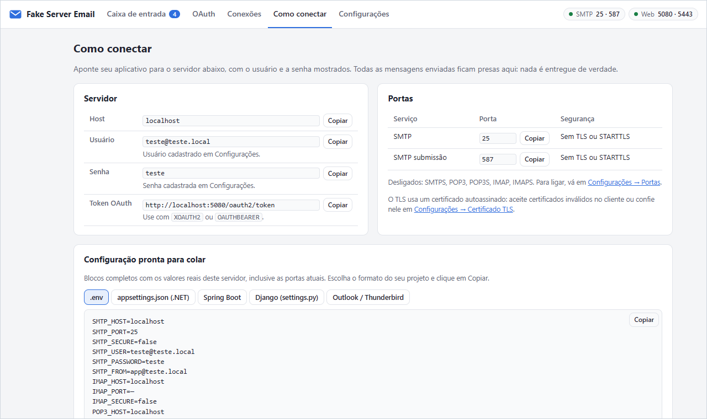
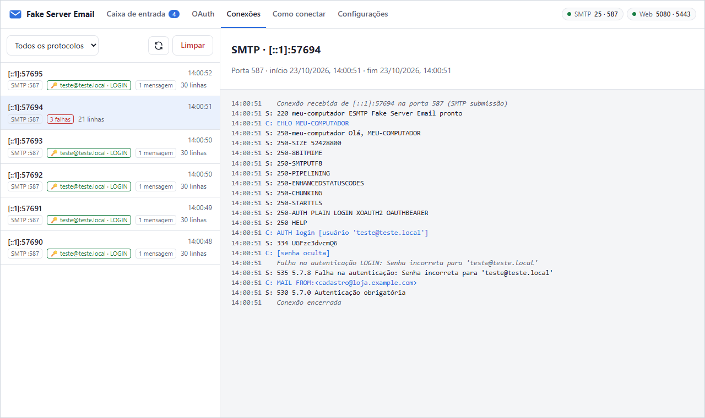

<div align="center">


# Fake Server Email

**A pretend email server for testing systems without sending real email to anyone.**

Every email the system under test sends is caught here, in an inbox in your browser.<br>
It is a single file for Windows: nothing to install, no server to set up.

<a href="https://github.com/lepton-tech/lepton-fake-server-mail/releases/latest/download/FakeServerEmail.exe"></a>

Different kind of Windows? [ARM processor](https://github.com/lepton-tech/lepton-fake-server-mail/releases/latest/download/FakeServerEmail-arm64.exe) · [32-bit](https://github.com/lepton-tech/lepton-fake-server-mail/releases/latest/download/FakeServerEmail-x86.exe) · [Which one do I have?](#which-file-to-download)

[](https://github.com/lepton-tech/lepton-fake-server-mail/releases/latest)
[](#which-file-to-download)
[](LICENSE)

[Which file to download](#which-file-to-download) · [First run](#first-run) · [Troubleshooting](#when-something-does-not-work) · [What's new](CHANGELOG.md)

[Português](README.md) · **English**

<br>



</div>

> [!NOTE]
> The app's screens are in Brazilian Portuguese. This guide shows each label as it appears on screen, followed by its meaning in English.

## Get started in 3 steps

1. **Download** `FakeServerEmail.exe` with the blue button above.
2. **Open** the file with a double-click. The inbox opens in your browser.
3. **Set up** the system you are testing to send email to server `localhost`, port `25`, user `teste@teste.local` and password `teste`.

That's it: every email the system sends shows up in the inbox right away. No email ever leaves your computer.

## What it is for

- ✉️ **Check the system's emails** (sign-up, password reset, notices, reports) with no risk of reaching real customers.
- 👀 **See the email the way the recipient would:** HTML, plain text, attachments and headers.
- 🧪 **Simulate real server situations:** wrong password, server that requires login, server without encryption, OAuth token login.
- 🔎 **Find out why a send failed**, with the full log of every connection.

## Download

### Which file to download

**If in doubt, download `FakeServerEmail.exe`: it works on almost every computer.**

| Your computer | File to download |
|---|---|
| Regular Windows 10 or 11 (64-bit). **This is most computers.** | ⬇️ [**FakeServerEmail.exe**](https://github.com/lepton-tech/lepton-fake-server-mail/releases/latest/download/FakeServerEmail.exe) |
| Windows on an ARM processor (Snapdragon, Surface Pro X) | ⬇️ [FakeServerEmail-arm64.exe](https://github.com/lepton-tech/lepton-fake-server-mail/releases/latest/download/FakeServerEmail-arm64.exe) |
| 32-bit Windows (older computers) | ⬇️ [FakeServerEmail-x86.exe](https://github.com/lepton-tech/lepton-fake-server-mail/releases/latest/download/FakeServerEmail-x86.exe) |

These links always download the latest version. Each file is about 50 MB.

<details>
<summary><b>How to find out which Windows I have</b></summary>

<br>

Open **Start → Settings → System → About** and look at the **System type** line:

| If it says... | Download |
|---|---|
| "64-bit operating system, x64-based processor" | `FakeServerEmail.exe` |
| "ARM-based processor" | `FakeServerEmail-arm64.exe` |
| "32-bit operating system" | `FakeServerEmail-x86.exe` |

</details>

Older versions and what changed in each one are on the [releases page](https://github.com/lepton-tech/lepton-fake-server-mail/releases) and in the [CHANGELOG](CHANGELOG.md) (in Portuguese).

### If the browser warns about the download

Because the program is new and not digitally signed, the browser may say the file "isn't commonly downloaded". This is expected.

- **Edge:** in the downloads list, click the three dots (**…**) next to the file, then **Keep**, **Show more** and **Keep anyway**.
- **Chrome:** in the downloads list, choose the option to keep the file.

## First run

1. Save the file somewhere easy to find, such as the **Desktop**. There is no installation: this file is the program.
2. Double-click it.
3. If the blue **"Windows protected your PC"** screen appears, click **More info** and then **Run anyway**. This only happens the first time.
4. A black window opens, and the browser shows the inbox at `http://localhost:5080`.

The black window shows the inbox address and the ports in use:

```
  Fake Server Email 1.0.0
  Servidor de e-mail falso para testes: SMTP, POP3, IMAP e OAuth 2.0

  Caixa de entrada: http://localhost:5080

  Serviço           Porta   Segurança
  SMTP              25      STARTTLS opcional
  SMTP submissão    587     STARTTLS opcional
```

> [!IMPORTANT]
> **Keep the black window open while you test.** Closing it shuts the server down. If you open the file again while it is already running, it just opens the existing inbox.

## Set up the system you are testing

In the system under test, find the email sending settings. They are usually called "SMTP", "mail server" or "outgoing mail". Fill them in like this:

| Field | Value |
|---|---|
| Server (host) | `localhost` |
| Port | `25` or `587` |
| User | `teste@teste.local` |
| Password | `teste` |
| Security (SSL/TLS) | none, or STARTTLS accepting an invalid certificate |

If you can't find these settings, ask whoever develops the system: they are the same fields as any mail server.

The **Como conectar** (How to connect) tab shows the real values for your computer. For example, if port 25 is taken, the server uses 2025, and that tab is where you see it. It also has ready-to-paste settings for `.env`, .NET, Spring Boot, Django, Outlook and Thunderbird, plus code samples in C#, Java, Python, Node.js and PowerShell.

<p align="center"></p>

> [!TIP]
> **Does the system run on another machine or in a Docker container?** Check **Aceitar conexões de outras máquinas e de containers Docker** (Accept connections from other machines and Docker containers) in **Configurações → Portas** (Settings → Ports). In Docker, use `host.docker.internal` as the server.

<details>
<summary><b>All services and ports</b></summary>

<br>

By default only sending email is turned on. The other services stay off until you need them.

| Service | Used for | Port | On by default |
|---|---|---|---|
| SMTP | sending email | 25 | yes |
| SMTP submission | sending email | 587 | yes |
| SMTPS | sending, encrypted from the start | 465 (suggested) | no |
| POP3 / POP3S | the system under test reading email | 110 / 995 (suggested) | no |
| IMAP / IMAPS | the system under test reading email | 143 / 993 (suggested) | no |
| Web interface | these screens | 5080 | always |
| HTTPS | OAuth login with libraries that require a secure connection | 5443 | yes |

SMTP and SMTP submission behave the same on this server. Both exist because each system comes configured with a different port. To turn a service on or off, use the checkboxes in **Configurações → Portas** (Settings → Ports). When turned on, it uses the suggested port, which you can change.

</details>

## The screens

- **Caixa de entrada** (Inbox): received emails, each one as HTML, text, headers and source, with attachments to download. The **Enviar teste** (Send test) button sends a sample message to check that everything works.
- **OAuth:** creates and revokes tokens to test OAuth 2.0 login.
- **Conexões** (Connections): the log of every connection, line by line. This is where you find out why a send failed.
- **Como conectar** (How to connect): this computer's connection details and ready-made samples.
- **Configurações** (Settings): users and passwords, sending rules, encryption, ports, certificate and stored data.

## Common test scenarios

| I want to test... | Where to change it |
|---|---|
| wrong password | it's the default: only `teste@teste.local` with password `teste` gets in. Add others in **Usuário e senha** (User and password) |
| a system that sends without login | uncheck **Exigir login para enviar pelo SMTP** (Require login to send via SMTP) |
| a server that accepts any password | **Usuário e senha → Aceitar qualquer usuário e senha** (Accept any user and password) |
| a server without encryption (no STARTTLS) | uncheck **Oferecer STARTTLS** (Offer STARTTLS) |
| a server that only accepts one login type (only PLAIN, for example) | **STARTTLS e mecanismos de login** (STARTTLS and login mechanisms) |
| a system that reads email via IMAP or POP3 | turn the service on in **Portas** (Ports) |
| login with an OAuth token (XOAUTH2, OAUTHBEARER) | **OAuth** tab |
| a message that is too large | **Tamanho máximo da mensagem** (Maximum message size) |
| trusted HTTPS for IIS, Windows services or Firefox | **Certificado TLS → Confiar para todo o computador** (TLS certificate → Trust for the whole computer) |

## When something does not work

<details>
<summary><b>The email did not arrive in the inbox</b></summary>

<br>

Open the **Conexões** (Connections) tab. It shows every attempt the system made to talk to the server, line by line.

- **No connection shows up:** the system is not reaching the server. Check that the black window is open and that the system's server and port match the **Como conectar** tab. If the system runs on another machine or in Docker, see the tip in [Set up the system](#set-up-the-system-you-are-testing).
- **The connection shows failures (in red):** the failure line tells you why. In the example below, the system used the wrong password.

<p align="center"></p>

</details>

<details>
<summary><b>The browser did not open the inbox</b></summary>

<br>

Open the browser and type `http://localhost:5080`. If port 5080 is taken, the program uses another one, and the right address appears in the black window, on the **Caixa de entrada** (Inbox) line.

</details>

<details>
<summary><b>"Windows protected your PC" appeared</b></summary>

<br>

Click **More info** and then **Run anyway**. The warning appears because the program has no digital signature, not because something is wrong with it.

</details>

<details>
<summary><b>The antivirus blocked or deleted the file</b></summary>

<br>

Some antivirus programs distrust software without a digital signature. Ask your IT team to allow `FakeServerEmail.exe`, then download the file again.

</details>

<details>
<summary><b>The system says the port is in use, or can't connect on port 25</b></summary>

<br>

When a port is already taken by another program, Fake Server Email picks another one on its own (25 becomes 2025, for example). The real port appears in the black window and in the **Como conectar** tab. Use that port in the system under test.

</details>

<details>
<summary><b>The system complains about a certificate, SSL or TLS</b></summary>

<br>

The simplest way is to set the system up with no security (SSL/TLS "none"). If the system requires a secure connection, use STARTTLS accepting an invalid certificate, or mark the certificate as trusted in **Configurações → Certificado TLS** (see [Certificate](#certificate-https-and-tls)).

</details>

<details>
<summary><b>Windows asked about the Firewall</b></summary>

<br>

This only happens when **Aceitar conexões de outras máquinas e de containers Docker** (Accept connections from other machines and Docker containers) is on. Click **Allow** so the system under test can reach the server from another machine or from Docker.

</details>

<details>
<summary><b>How to update to a new version</b></summary>

<br>

Close the black window, download the file again with the [button at the top](#which-file-to-download) and replace the old one. Your emails and settings stay, because they are stored outside the file. The version in use appears on the first line of the black window, and what changed in each version is in the [CHANGELOG](CHANGELOG.md).

</details>

## Certificate (HTTPS and TLS)

Encrypted connections use a certificate the program creates for `localhost` on first use. To make systems accept it without warnings, there are two options in **Configurações → Certificado TLS** (Settings → TLS certificate):

- **Só para o meu usuário** (Only for my user): covers the programs you open (Chrome, Edge, .NET apps). No administrator needed; Windows shows a confirmation.
- **Para todo o computador** (For the whole computer): also covers IIS, Windows services, other users and Firefox (when it uses the Windows certificates). Windows asks for administrator permission.

The certificate is only valid for `localhost` and is not a certificate authority: even if someone copies the key, it can't be used for other sites. To install it from the command line, download the `.cer` on the same screen and run, as administrator:

```powershell
Import-Certificate -FilePath .\fake-server-email-localhost.cer -CertStoreLocation Cert:\LocalMachine\Root
```

## Data and removal

Emails, settings, the certificate and the OAuth key are stored in `%LOCALAPPDATA%\FakeServerEmail`. Each email is an `.eml` file.

In **Configurações → Dados guardados** (Settings → Stored data) you can open that folder, delete only the emails and tokens, or remove everything the program saved. Removal also takes the certificate off the Windows trusted list (for the user or the computer). After that, just delete the `.exe`: nothing else is left on the computer.

Command-line options:

| Option | What it does |
|---|---|
| `--data <folder>` | stores the data in another folder |
| `--no-browser` | does not open the browser on startup |
| `--mcp` | MCP mode over stdio, for AI agents (see below) |

## AI agents (MCP)

The same executable is an [MCP](https://modelcontextprotocol.io/) server, built with the official .NET SDK (`ModelContextProtocol`). With it, agents such as Claude Code, Claude Desktop, Cursor, VS Code and Codex read, wait for and send emails, create tokens and change the server rules. There are two ways to connect:

- **HTTP:** `http://localhost:5080/mcp`, while the app is open.
- **stdio:** `FakeServerEmail.exe --mcp`. The agent starts the process. If the app is already open, it uses the same server; if not, it starts one in the background that exits with the agent.

```powershell
claude mcp add --transport http fake-email http://localhost:5080/mcp
claude mcp add fake-email -- "C:\path\FakeServerEmail.exe" --mcp
```

The **Como conectar** (How to connect) tab shows the ready-made configuration for each agent, with the real path of the executable.

| Tool | Used for |
|---|---|
| `server_info` | real ports, authentication rules, OAuth endpoints |
| `list_messages`, `get_message`, `get_message_source` | reading emails (with links extracted from the body) |
| `wait_for_message` | waiting for the email after triggering an action in the system under test |
| `get_attachment` | attachments as text, image or file on disk |
| `send_email` | simulating incoming messages for clients that read via IMAP/POP3 |
| `delete_messages`, `mark_messages` | clearing the inbox, marking as read or unread |
| `create_oauth_token`, `list_oauth_tokens`, `revoke_oauth_token` | tokens for XOAUTH2/OAUTHBEARER and rejection tests |
| `list_connections`, `get_connection_log` | debugging why the system couldn't send or authenticate |
| `update_settings` | users and passwords, requiring SMTP login, STARTTLS, login mechanisms, ports (0 turns the service off), token lifetime, etc. |

## Technical details

- **Authentication:** PLAIN, LOGIN, XOAUTH2 and OAUTHBEARER mechanisms, with STARTTLS (STLS on POP3) on the ports without TLS. You can choose which mechanisms to advertise and turn STARTTLS off, to mimic more limited servers.
- **OAuth 2.0:** `authorization_code` with PKCE, `refresh_token`, `client_credentials`, `password` and `device_code`, with OIDC discovery, JWKS and Microsoft-style routes (`/{tenant}/oauth2/v2.0/token`). Tokens are signed JWTs, and the mail services reject expired, revoked or other users' tokens.
- **Interface security:** the API rejects requests coming from other sites open in the browser and, with network access off, only answers addresses on this computer. HTML and SVG attachments of captured emails open isolated, without running scripts.
- **SMTP:** ESMTP with SIZE, 8BITMIME, SMTPUTF8, PIPELINING, CHUNKING (BDAT) and enhanced status codes.
- **IMAP:** IMAP4rev1 with IDLE, UIDPLUS, MOVE, SPECIAL-USE and folders (Sent, Drafts, Trash, Junk, Archive).

## For developers

Requires Windows and the [.NET 10 SDK](https://dotnet.microsoft.com/download).

```powershell
dotnet run --project src\FakeServerEmail          # run from source
dotnet test                                       # end-to-end tests
.\scripts\publicar.ps1                            # builds dist\FakeServerEmail.exe (x64)
.\scripts\publicar.ps1 -Runtime win-x64,win-x86,win-arm64 # also 32-bit and ARM
```

The architecture and conventions are described in [CLAUDE.md](CLAUDE.md), and the branch, pull request, changelog and release flow in [CONTRIBUTING.md](CONTRIBUTING.md). Both are in Portuguese, like the screens and logs.

## License

[MIT](LICENSE).
